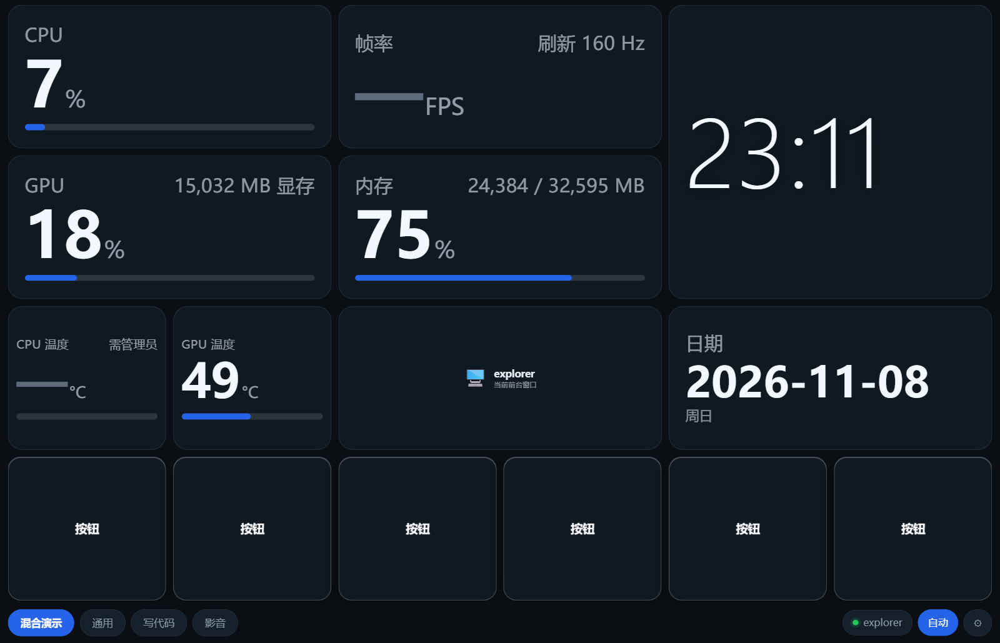
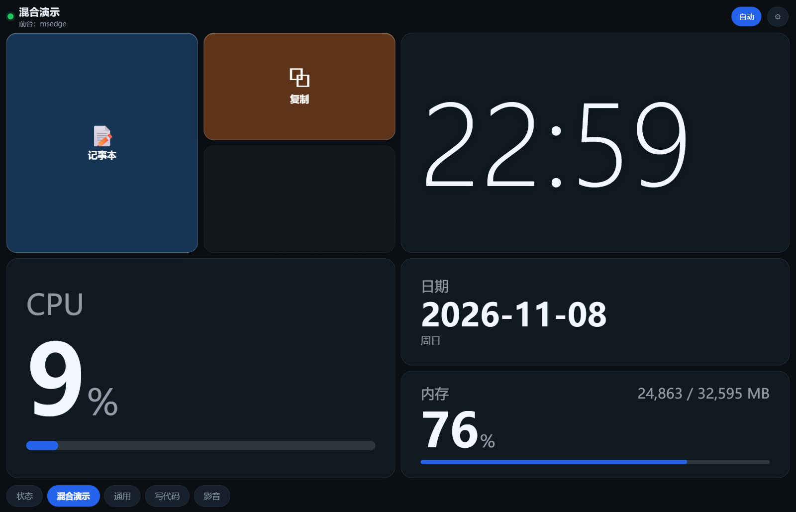
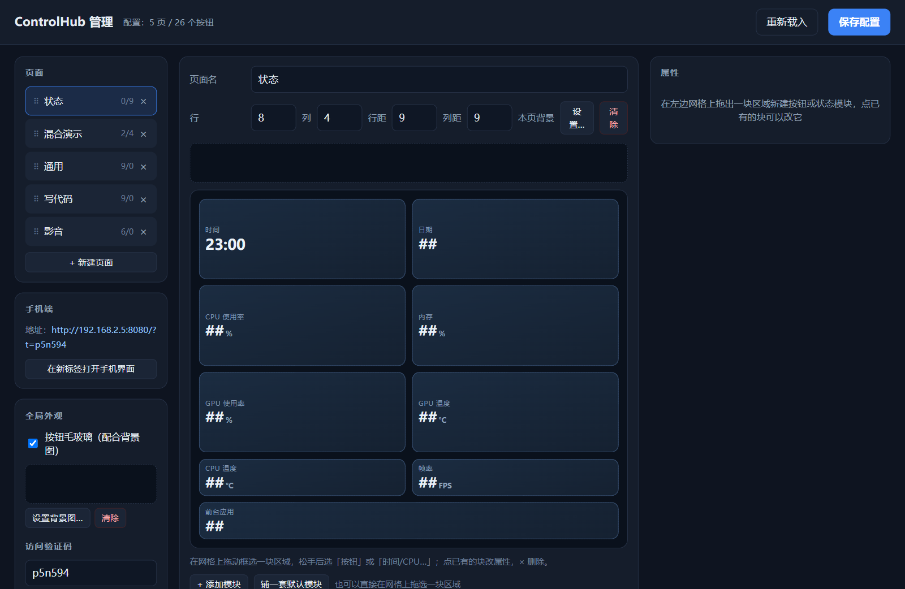
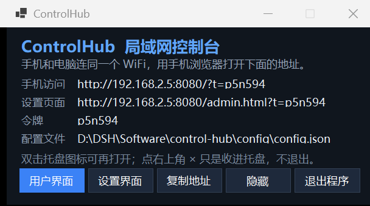

# ControlHub · 手机当电脑的遥控键盘

手机浏览器（或装到桌面变成 App）打开一个按钮面板，点一下就代替你在电脑上：
**启动程序 / 打开文件或文件夹 / 输入一段文字 / 按快捷键（含 Ctrl、Shift、Alt、Win）**。
按钮可以分很多页，电脑还能根据当前前台程序**自动切到对应那页**。

- 电脑端：C# / .NET 10，单个 exe，HTTP + WebSocket 服务
- 手机端：PWA（一个网页，可“添加到主屏幕”，不用装 APK）

## 截图

| 手机端按钮页 | 一页里按钮 + 状态模块混排 |
|---|---|
|  |  |

| 电脑端管理页 | 托盘图标弹出的状态窗口 |
|---|---|
|  |  |

---

## 1. 怎么启动

双击桌面上的 **「ControlHub 控制台」** 快捷方式，或者双击 `dist\ControlHub.exe`。

启动后**没有窗口**，只在右下角托盘区出现一个图标（Windows 11 可能把它收进 `^` 溢出区，
拖到常显区就不会被收起）。

- **双击托盘图标** → 打开状态小窗口（手机地址、设置地址、令牌、配置文件位置，以及「用户界面 / 设置界面 / 复制地址 / 隐藏 / 退出程序」五个按钮）。
- **右键托盘图标** → 菜单：打开用户界面、打开设置界面、显示窗口、退出程序。
- 点窗口右上角 **×** 或者「隐藏」，只是把窗口收起来，服务继续跑。
- 要真正停止：托盘右键 **退出程序**，或者窗口里的「退出程序」。
- 只想看一次窗口：`ControlHub.exe --show`。
- 已经在运行时再双击，只会弹一句「已经在运行了（看右下角托盘图标）」，不会开第二份。

**程序和配置是分开的**，重新编译 / 重新发布只覆盖 `dist`，不会动你的配置：

```
D:\DSH\Software\control-hub\
├─ dist\              程序本体（ControlHub.exe、网页、启动脚本）——更新时整个替换
└─ config\            你自己的东西——不要删、更新程序也不会碰
   ├─ config.json     页面、按钮、映射、背景设置、验证码
   ├─ startup.log     每次启动的一行记录（时间、地址、托盘状态）
   └─ uploads\        你上传的背景图和图标
```

启动时程序会自动找到同级的 `config` 文件夹并读取其中的 `config.json`；
找不到就在 `config`（有的话）或 exe 旁边新建一份默认配置。
想换位置也可以：设环境变量 `CONTROLHUB_HOME=D:\某个目录` 指向自定义目录。

启动细节写进 `config\startup.log`，例如：

```
2026-11-09 00:12:19 启动
配置文件: ...\control-hub\config\config.json
令牌: p5n594
手机: http://192.168.2.5:8080/?t=p5n594
设置: http://192.168.2.5:8080/admin.html?t=p5n594
00:12:19 托盘图标已就绪（可见=True）
```

第一次运行时 Windows 可能弹“防火墙”提示，要选**允许**（专用网络打勾即可，公用网络不用勾）。

## 2. 手机怎么连

1. 手机和电脑连**同一个 WiFi**（同一局域网）。
2. 手机浏览器输入控制台里那条 `http://192.168.x.x:8080/?t=xxxxxx` 地址。
   地址里的 `?t=` 是令牌，第一次打开后手机会记住，以后可以直接开。
3. 想更像 App：浏览器菜单里选「添加到主屏幕」，图标和全屏都配好了。
4. 手机端**没有顶栏**，整屏都是按钮。最底下一行：左边是页签，右边（右对齐）依次是「● 当前前台程序」「自动」「⚙」三个同样式的小胶囊。点「自动」切换**要不要跟着电脑前台程序自动切页**，关掉就只能手动点页签。
5. 左右滑动屏幕也能翻页：横向划出 64 像素以上、并且明显偏横向（不是斜着划）就切到上一页/下一页，
   到末尾会循环。从按钮上开始划也可以——那个手势会被当成翻页，不会误触发按钮；往上下滑不算翻页。
6. **只有「按下再松开」才算按了一次**：手指按住按钮时按钮会缩小，松开时才执行；
   松手时手指已经滑到别的格子上、或者滑动距离超过 12 像素，就什么都不做（防止误触）。
7. **打开页面时总是先显示页签里排在第一位的那一页**（想换默认首页就在管理页拖动页面排序）；
   只有断线重连时才会留在你当时正在看的那一页。
7. 想调顺序：**长按页面标签**（约半秒）拖动可换页序；在页面上**长按按钮**拖动可换按钮位置。
8. 新建按钮时把动作设成 `prompt`，手机点它就弹出输入框，打完字按「发送」，文字才会打到电脑上。

## 3. 怎么改按钮

电脑浏览器打开 **`http://127.0.0.1:8080/admin.html?t=<令牌>`**（管理页地址在控制台里也有提示）。

界面分三栏：

- **左**：页面列表（新建 / 删除 / 拖动 ⠿ 换序，最多 12 页）、手机端地址、「在新标签打开手机界面」、
  「全局外观」（毛玻璃开关、默认背景图）、「访问验证码」
- **中**：页面名、行数、列数、行距、列距、本页背景图，下面是一块**自由网格**
  （拖出一块区域松手，选「按钮」或「时间 / CPU…」；点已有的块改属性，× 删除），
  再下面是「按前台程序自动切页」的映射表
- **右**：选中按钮后的属性——文字、图标（emoji 或**上传图片**）、副标题、颜色、动作类型、
  以及「在这台电脑上试一下」

改完点右上角 **保存配置**，手机端会自动刷新，不用重连。

### 动作类型

| 类型 | 作用 | 关键字段 |
|---|---|---|
| `app` | 启动程序 | 程序路径（可写 `notepad.exe`、`C:\...\xxx.exe`，支持 `%USERPROFILE%` 等环境变量）、启动参数 |
| `open` | 用默认程序打开文件/文件夹 | 路径 |
| `text` | 往当前窗口输入文字 | 文本；方式 `type`（逐字注入，默认）或 `paste`（写剪贴板再 Ctrl+V，个别输入框更稳） |
| `hotkey` | 按组合键 | `["ctrl","shift","s"]`，也可写 `"ctrl+shift+s"` |
| `sequence` | 按顺序执行上面几种 | 步骤列表，每步可带「等待毫秒」 |
| `prompt` | 手机上弹输入框，确认后把文字打到电脑 | 输入方式 `type`（默认）或 `paste` |

`sequence` 很适合做「打开某个软件 → 等 2 秒 → 输入一段话 → 回车」。

`hotkey` 认得的按键名（大小写都行）：`ctrl` `shift` `alt` `win`、`enter` `tab` `esc` `space` `backspace`
`delete` `insert` `home` `end` `pageup` `pagedown`、四个方向键、`capslock` `printscreen` `pause`、
字母 `a`–`z`、数字 `0`–`9`、`F1`–`F24`、
符号（写成字符串即可）：`;` `=` `,` `-` `.` `/` 反引号 `[` `\` `]` `'`，
以及媒体键 `volumeup` `volumedown` `volumemute`（系统音量）、
`mediaprevioustrack` `medianexttrack` `mediaplaypause` `mediastop`。

> **媒体键 vs 空格**：`mediaplaypause` 是真正的系统媒体键，会交给 Windows 当前的多媒体会话，
> 播放器在后台也能暂停/播放（网易云、QQ 音乐、Spotify、浏览器里的 B 站/YouTube 都支持）。
> 只有少数老播放器不响应媒体键、只吃空格，所以「影音」页里另放了一个 `空格` 按钮——按了没反应时换它试。
> 媒体键走的是前台窗口，如果目标窗口是管理员权限，ControlHub 也要以管理员运行。

### 每页都是一块自由网格（按钮和状态模块混着放）

没有「按钮页 / 状态页」之分了：**每一页都是同一套格子**，格子上既可以放按钮，也可以放时钟、CPU、温度这类实时模块，
还能一行放按钮、下一行放仪表盘。

- 页面有「行 / 列」两个数字（默认 3×3，最大 10×10；出厂第一页「状态」是 8 行 × 4 列 = 32 格）；
- 每个块可以占一格，也可以横跨几格、纵跨几格（按钮和模块都支持「行跨 / 列跨」）；
- 块之间不许重叠，放不下会提示「这块区域已经被占用了」。

模块类型：

| 类型 | 显示内容 |
|---|---|
| 时间 | `22:17` 大号时钟 |
| 日期 | `2026-11-08` + 星期 |
| 前台应用 | 进程名 + 窗口标题 |
| CPU 使用率 / 内存 | 百分比 + 进度条（内存带已用/总量） |
| GPU 使用率 | 百分比 + 进度条（带显存占用） |
| CPU 温度 / GPU 温度 | 摄氏度 + 进度条 |
| 帧率 | FPS（拿不到时显示「—」），并注明刷新率 |
| 刷新率 | 只显示 Hz |
| 静态文字 | 自己写一句话 |

**在管理页怎么摆**：中栏那块虚线网格就是画布——

- 在空格子上**按住拖出一个矩形**，松手会弹出一个小菜单，选「按钮」或某种模块就建好了；
- **点一下**某个空格子，建一个 1×1 的块；
- 点已有的块选中它，右栏改属性（按钮：文字/图标/颜色/动作/行跨列跨；模块：类型/标题/颜色/行跨列跨），或者删掉；
- 网格下方「+ 添加模块」自动找空位放一个，「铺一套默认模块」恢复成出厂那九个模块。

数据每秒刷新：服务端每 0.1 秒采样、每秒推给所有连着手机的连接，另外手机自己每 3 秒兜底拉一次
`/api/stats`。字号会按块的实际大小自动缩放，所以横跨两格的字会比一格的大。

### 外观：背景图 / 毛玻璃 / 文字颜色 / 图标图片

- **间距**：每页可以单独设「行距」和「列距」（0–60 px，默认 9），两者独立——想做成上下宽松、左右紧凑，
  就把行距调大、列距调小；设 0 就是按钮贴在一起。状态页的模块间距同样按这两个值走。
- **背景图**：「全局外观」里设的是所有页面的默认背景；某页单独设的背景优先。图片直接从手机相册
  或电脑里选，上传后存在 `config\uploads\`，最大 12 MB（png / jpg / webp / gif / bmp / ico）。
- **毛玻璃**：勾上「按钮毛玻璃」，按钮会半透明并把背后的背景图模糊掉（`backdrop-filter`）。
  两个滑杆分开调，互不影响：
  - **颜色透明度** 0–100%：0 = 按钮颜色实心不透明，60 ≈ 默认观感，100 = 颜色全透明、只剩一层模糊。
  - **模糊程度** 0–100%：0 = **完全不模糊**，背景图原样从按钮里透出来（清楚看见底图）；
    100 = 最糊（模糊半径 30 px）。中间值线性过渡，60 大概 18 px。
- **毛玻璃也管状态模块**：同一页里的时间 / CPU / 内存这些模块跟按钮走**完全相同**的规则——
  一样的两个滑杆、一样的每页覆盖、一样的模糊 0% 不模糊；文字同样按「面板色盖在背景上」的合成亮度
  自动切黑/白，所以浅背景下模块里是黑字、深背景下是白字。
- **每页单独设**：每页页面设置里有「本页毛玻璃」（跟随全局 / 开 / 关）和它自己的两个滑杆。
  选「跟随全局」时滑杆变灰、显示「继承 60% / 继承 50%」；选了开或关就拥有独立值，和别的页互不影响。
  背景图同理：本页设了就用自己的，没设才用全局的。
- **文字颜色自动黑/白**：不用自己挑。程序会按按钮底色（毛玻璃时按背景图平均亮度）算相对亮度，
  自动在黑、白里选更醒目的那个，所以浅色按钮上是黑字、深色按钮上是白字。
- **图标图片**：按钮属性里可以给单个按钮上传图标图片，优先级高于 emoji。

### 自动切页

在映射表里写「进程名（不含 .exe）→ 目标页」，比如：

```
devenv   → 写代码
notepad  → 通用
vlc      → 影音
```

电脑每隔 0.4 秒看一次前台窗口的进程名，变了就按映射给所有开着「自动」的手机推新页。
映射里没有的程序，回到 `config.json` 里 `defaultPage` 指定的页面。

点「用当前前台程序添加」可以不用手打进程名：先把目标软件切到前台，再点这个按钮。

## 4. 配置文件

配置就一个 `config\config.json`，纯文本，UTF-8（和程序分开存，更新程序不会动它）。**改之前建议关掉服务**（管理页保存是原子的，
手改则可能与内存里的配置打架）。字段含义见文件里的结构，最外层：

```json
{
  "token": "p5n594",        // 手机端令牌；改成别的值就换新地址，留空 "" = 关闭验证
  "port": 8080,             // 端口，改了要重启
  "defaultPage": "default", // 没有映射时显示的页
  "autoSwitchDefault": true,
  "background": "/uploads/261108-220158-5264ba.png",  // 全局背景图，空 = 无
  "glass": false,           // 全局毛玻璃开关
  "glassAlpha": 60,         // 全局：颜色透明度 0–100（0=实心，100=颜色全透明）
  "glassBlur": 50,          // 全局：模糊程度 0–100（0=完全不模糊，100=30px）
  "pages": [
    { "id": "status", "name": "状态", "rows": 8, "cols": 4,
      "background": null, "glass": null, "glassAlpha": null, "glassBlur": null, "buttons": [],
      "widgets": [
        { "id": "w1", "kind": "clock", "row": 0, "col": 0, "rowSpan": 2, "colSpan": 2 },
        { "id": "w9", "kind": "app",   "row": 7, "col": 0, "rowSpan": 1, "colSpan": 4 }
      ] },
    { "id": "default", "name": "通用", "rows": 3, "cols": 3,
      "rowGap": 9, "colGap": 9,
      "buttons": [ { "id": "b1", "row": 0, "col": 0, "label": "记事本", "icon": "📝",
                     "iconImage": null, "color": "#2563eb",
                     "action": { "type": "app", "path": "notepad.exe" } } ] }
  ],
  "mappings": [ { "process": "notepad", "pageId": "default" } ]
}
```

- `token` 留空就是**不要验证码**（同一局域网的任何人都能连），换值后手机要用新地址。
- `kind`：老版本的「页面类型」，现在**已经不分类型了**，保留只是向后兼容，写不写都行。
- `rowGap` / `colGap`：这一页所有块的行间距、列间距，单位 px，默认 9，范围 0–60。
- 任何页面都可以用 `widgets` 摆模块：`kind` 取 `clock/date/app/cpu/mem/gpu/cputemp/gputemp/fps/hz/label`，
  `row`/`col` 从 0 开始，`rowSpan`/`colSpan` 是跨几格，可选 `title`（自定义标题）、`text`（静态文字）、`color`。
- 按钮同样有 `rowSpan`/`colSpan`（默认 1），所以按钮也能跨格，和模块摆在同一张网格里。
- `action.type`：`app` / `open` / `text` / `hotkey` / `sequence` / `prompt`。
- 背景图与图标图都是上传后的相对路径（`/uploads/xxx.png`）。
- 每页的 `glass` / `glassAlpha` / `glassBlur` 为 `null`（或干脆不写）表示跟随全局；写 `true`/`false` 和 0–100
  就在这一页覆盖全局，页与页之间互不影响。`background` 同理：本页写了就用本页的，`null` 才用全局。
- 老配置里只有一个 `glassOpacity` 也能用：程序启动时会把它同时换算成 `glassAlpha` 与 `glassBlur` 并清掉旧字段。

令牌别设得太短，同网段的人猜到就能按你的键。忘了令牌就看控制台输出，或看 `config.json`。

## 5. 常见问题

- **手机打不开**：先确认在同一个 WiFi；再确认控制台窗口还开着；然后看防火墙有没有放行
  （专用网络允许 `ControlHub.exe`）。公司/学校 WiFi 常开「客户端隔离」，那样手机和电脑互相不可见，只能换热点。
- **点了没反应**：程序或文件路径写错了；或者目标窗口以管理员身份运行，而本程序不是管理员——
  Windows 不允许低权限进程往高权限窗口发按键。要控制管理员窗口，就把 `ControlHub.exe` 也用管理员身份启动。
- **输入中文进不去某个框**：把该按钮的动作方式改成 `paste`。
- **端口被占用**：改 `config.json` 里的 `port`，或先找出占 8080 的程序。
- **状态页 CPU 温度是「—」**：读 CPU 温度要走主板传感器内核驱动，**以管理员身份运行** `ControlHub.exe` 才有；
  普通权限下 GPU 温度和负载仍然有（走显卡驱动）。
- **状态页帧率是「—」**：桌面合成器的帧率要么拿不到、要么没意义（静止桌面本来就不刷新），
  所以只稳定显示刷新率（如 160 HZ）。游戏内的真实帧率需要 ETW/PresentMon 级别的采样，本程序没做。
- **改了验证码连不上**：手机存的还是旧地址。清掉浏览器缓存或手动换成新地址；管理页保存后会提示新地址。
- **想换电脑用**：整个 `dist` 文件夹拷过去即可（单文件 exe 自带运行时，不需要装 .NET）。

## 6. 二次开发

```powershell
$env:DOTNET_ROOT = "D:\software_AI\dotnet-sdk-10"          # 便携版 SDK
$env:NUGET_PACKAGES = "D:\DSH\Software\control-hub\.nuget"
& "$env:DOTNET_ROOT\dotnet.exe" build   "D:\DSH\Software\control-hub\ControlHub.csproj" -c Release
& "$env:DOTNET_ROOT\dotnet.exe" publish "D:\DSH\Software\control-hub\ControlHub.csproj" -c Release `
    -r win-x64 --self-contained true -p:PublishSingleFile=true `
    -p:IncludeNativeLibrariesForSelfExtract=true -p:EnableCompressionInSingleFile=true `
    -o "D:\DSH\Software\control-hub\dist"
```

源码结构：

```
ControlHub.csproj      项目文件
Models.cs              配置模型（页面 / 按钮 / 动作）
ConfigStore.cs         config.json 读写、默认配置、令牌生成
Stats.cs               状态页数据采集（CPU / 内存 / GPU / 温度 / 刷新率 / 前台应用）
Actions.cs             Win32 动作执行：启动程序、打开、打字、快捷键、序列
ForegroundMonitor.cs   前台窗口轮询（自动切页的数据来源）
Hub.cs                 WebSocket 连接管理
Program.cs             Kestrel 启动、REST 接口、WebSocket 协议
wwwroot/               手机端 PWA（index.html / app.js / style.css / manifest / 图标）
wwwroot/admin.html     电脑端管理页
tests/TypeProbe/       打字/快捷键验证用的小窗口（不影响主项目）
tools/                 图标生成、WebSocket 测试脚本
dist/                  发布产物：ControlHub.exe + wwwroot（每次更新整个替换）
config/                用户配置：config.json + uploads/（更新程序不会碰）
```

协议（自己写客户端时用得上）：

- `GET /api/state` 页面、当前页、前台程序
- `GET /api/stats` 状态页的实时数据（CPU / 内存 / GPU / 温度 / Hz / 前台应用）
- `GET /api/config` / `PUT /api/config` 读/写整份配置
- `POST /api/upload` 传图（multipart 字段 `file`）→ `{ ok, url }`，背景图与按钮图标都走它
- `POST /api/action` 立即在电脑上执行一个动作 `{ "type": "hotkey", "keys": ["ctrl","s"] }`
- `GET /api/info` 端口、令牌、可用地址、配置路径、版本
- `WS /ws?t=<令牌>`：服务端推 `hello` / `page` / `app` / `stats` / `config` / `flash` / `toast`，
  客户端发 `press`（按按钮，`prompt` 按钮多带一个 `text` 字段）、`goto`（切页）、`auto`（开关自动切页）、`ping`

所有 `/api` 与 `/ws` 都要带令牌：query `?t=...` 或请求头 `X-Token`；`config.json` 里 `token` 为空时完全不校验。

## 手机上怎么算“按下”

按钮**在松手的时候才发指令**：按下只是高亮，手指抬起时如果还在这颗按钮上，才把动作发给电脑。
手指滑出按钮区域再松开、或者滑动距离超过 12px（翻页/滚动的意图），都不会触发——
这样竖向滑动翻页时不会误按到按钮。

长按 0.5 秒进入拖动排序，此时松手是排序而不是按键。

如果手机上还是旧的交互（一按就发、或看不到状态页），把这个页面彻底刷新一次：
下拉刷新，或者关掉标签页重新打开。服务端已经对页面和脚本关闭了缓存，
之后的更新刷新就能拿到，不需要再手动清缓存。